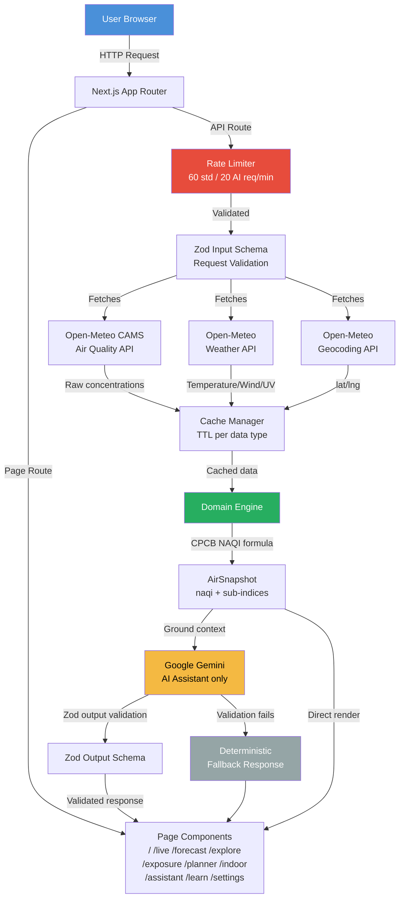

<div align="center">

# 🌬️ AirAware AI 2.0

### Urban Air Quality Intelligence Platform

**Understand Your Air. Predict Your Exposure. Make Better Decisions.**

[](https://github.com/yakash7845/airaware-ai-2)
[](https://github.com/yakash7845/airaware-ai-2)
[](https://github.com/yakash7845/airaware-ai-2)
[](https://github.com/yakash7845/airaware-ai-2)
[](https://github.com/yakash7845/airaware-ai-2)
[](https://github.com/yakash7845/airaware-ai-2)
[](https://nextjs.org/)
[](https://www.typescriptlang.org/)
[](LICENSE)

*Built for PromptWars — Challenge 6: Urban Air Quality Assistant*

</div>

---

## 📖 Overview

**AirAware AI 2.0** is a full-stack urban air quality intelligence platform that transforms raw regional atmospheric model data into transparent, location-aware, multilingual, and deeply actionable environmental guidance. It is not a widget that wraps a third-party AQI number — it is a deterministic science engine combined with grounded generative AI, deployed across **10 purpose-built pages** to answer the questions that matter most to urban residents.

Built on the **India CPCB National Air Quality Index (NAQI)** standard, every AQI figure in AirAware AI 2.0 is computed piecewise-linearly from raw pollutant concentrations with full methodology transparency. The underlying data is sourced exclusively from [Open-Meteo CAMS Air Quality](https://open-meteo.com/en/docs/air-quality-api) — a CC BY 4.0 regional atmospheric model covering approximately 45 km grid resolution across South Asia and beyond.

The platform answers **six deeper questions** that generic AQI dashboards cannot:

1. 🔬 **What is current air quality?** — CPCB NAQI calculated deterministically, not fetched from a black-box API.
2. 🧪 **Which pollutants are driving it?** — PM₂.₅, PM₁₀, CO, NO₂, SO₂, O₃ sub-indices with breakpoints and WHO limits.
3. 📈 **How will conditions change?** — 48-hour historical vs. 72-hour forecast curves with rule-based event detection.
4. 🗺️ **How do cities compare?** — Interactive multi-city comparison with Leaflet OpenStreetMap explorer.
5. 👨‍👩‍👧 **What does it mean for my household?** — Age-stratified exposure guidance (Child, Teen, Adult, Senior, General).
6. 🏃 **What practical decisions can I make?** — Forecast-ranked outdoor activity planner and indoor air advisor.

---

## 🌟 The 6 Core Questions — Answered

| # | Question | Page(s) | Technology |
|---|---|---|---|
| 1 | What is the current AQI right now? | `/` Overview, `/live` Live | CPCB NAQI piecewise interpolation, Open-Meteo CAMS |
| 2 | Which pollutants are worst? | `/live` Live Air Quality | 6-pollutant sub-index cards, CPCB/WHO breakpoint tables |
| 3 | How will air quality change over time? | `/forecast` Forecast Intelligence | 72h hourly data, 6 rule-based event detectors |
| 4 | How do different cities compare? | `/explore` Explore Map | Leaflet + OSM, `POST /api/compare`, presets for 5 cities |
| 5 | What does it mean for my age group? | `/exposure` Personal Exposure | Browser-local profiles, age-stratified guidance engine |
| 6 | When and where should I go outdoors? | `/planner`, `/indoor` | Server-computed ranking, 6 activity types, non-sensor disclaimers |

---

## ✨ Feature Highlights

| Feature | Description | Technology |
|---|---|---|
| 🔢 Deterministic NAQI | CPCB piecewise linear AQI from raw concentrations — no black-box APIs | TypeScript domain engine |
| 🌐 Multilingual UI | Full EN / தமிழ் / हिन्दी toggle on every page, table, modal, and option | React context, `languageContent.ts` |
| 🗺️ Interactive Map | Leaflet + OpenStreetMap with ~45 km coverage circles and multi-city comparison | Leaflet 1.9.4, `POST /api/compare` |
| 📊 Forecast Intelligence | 72h hourly forecast with PM₂.₅/PM₁₀/O₃ event detection (6 rule types) | Open-Meteo forecast endpoint |
| 👨‍👩‍👧 Household Profiles | Per-person exposure guidance; Child, Teen, Adult, Senior, General | Browser localStorage, Zod schemas |
| 🏃 Outdoor Planner | Ranks 2-hour windows for 6 activities across the forecast | `POST /api/best-window` |
| 🏠 Indoor Advisor | Infiltration + hygiene guidance with mandatory non-sensor disclaimers | `POST /api/indoor-advisor` |
| 🤖 AI Assistant | Gemini-powered grounded answers with Zod-validated structured responses | Gemini API, `POST /api/chat` |
| 🔒 Security Hardened | 9 security controls: rate limiting, CSP/HSTS, prompt injection defense, Zod output validation | Custom middleware, `headers.ts` |
| ♿ Fully Accessible | WCAG 2.2 AA, 0 Axe violations, focus trap, keyboard nav, reduced motion | axe-core, Playwright a11y tests |
| 📚 Environmental Education | 9 multilingual learning topics with CPCB sandbox calculator and particle scale diagram | `learningContent.ts`, custom components |
| ⚡ Zero Client Secrets | All API keys server-side only; `GEMINI_API_KEY` never reaches the browser | Next.js API Routes, server-only pattern |
| 🧪 High Test Coverage | 37 tests (unit + integration + a11y + E2E), 90.66% line coverage | Vitest, Playwright, Testing Library |
| 🏗️ Clean Architecture | Domain → Services → API → UI separation; 4 enforced invariants | TypeScript strict mode, ESLint |

---

## 🗂️ 10 Routes — Deep Dive

### `/` — Overview Dashboard

The **entry point** of the application. Provides a guided first-run onboarding flow for new users, then displays:

- **AQI Gauge** — Animated circular gauge showing overall NAQI with category label and color
- **Weather Summary** — Temperature, humidity, wind speed, and UV index from Open-Meteo
- **Analytical Insights** — 3–5 auto-generated plain-language insights derived from current data
- **Event Alerts** — Any detected events (spikes, surges, rapid deteriorations) from the forecast engine
- **48-Hour Trend Chart** — Interactive `HourlyTrendChart` SVG with keyboard-accessible Prev/Next Hour controls
- **Onboarding Guide** — Step-by-step first-run modal (`OnboardingGuide.tsx`) persisted to localStorage

**Key components:** `AqiGauge`, `WeatherSummary`, `AnalyticalInsights`, `HourlyTrendChart`, `OnboardingGuide`  
**Data:** `GET /api/air`, `GET /api/weather`

---

### `/live` — Live Air Quality

Deep-dive into the **current pollutant breakdown** with full CPCB methodology transparency.

- **Mode Toggle** — Switch between 24h/8h rolling CPCB NAQI and 1-hour indicative AQI
- **Calculation Modal** — Expandable transparency panel showing sub-index formula, averaging periods, breakpoint table, and provenance statement
- **Pollutant Cards** — 6 cards (PM₂.₅, PM₁₀, CO, NO₂, SO₂, O₃) showing concentration, sub-index, CPCB limit, WHO limit, and health context
- **Chart/Table Toggle** — Switch between visual bar chart and sortable data table view

**Key components:** `PollutantCard`, `CalculationModal`, `AqiModeToggle`, `PollutantBarChart`  
**Data:** `GET /api/air` → AirSnapshot domain type

---

### `/explore` — Explore Map

Client-side interactive **geographic explorer** using Leaflet and OpenStreetMap tiles.

- **City Presets Bar** — Quick-select for Chennai (default), Coimbatore, Bengaluru, Mumbai, Delhi (`ExploreCityBar.tsx`)
- **Coverage Circles** — ~45 km radius circles per CAMS grid cell with AQI-colored fill
- **Multi-City Comparison** — `POST /api/compare` returns a ranked comparison table with delta indicators
- **Comparison Table** — Sortable table component (`ComparisonTable.tsx`) with NAQI, PM₂.₅, PM₁₀, O₃ per city

**Key components:** `LeafletMap`, `ExploreCityBar`, `ComparisonTable`  
**Data:** `POST /api/compare`

---

### `/forecast` — Forecast Intelligence

72-hour forward view with **rule-based event detection** and daily summaries.

- **Hourly Inspector** — Step through each forecast hour; hover/focus shows exact pollutant values
- **Daily Summary Grid** — `DailySummaryGrid.tsx` shows min/avg/max AQI per day with dominant pollutant
- **Event Detection List** — `EventDetectionList.tsx` surfaces detected events with severity, trigger time, and plain-language description
- **6 Event Types Detected:**
  - `PM25_SPIKE` — PM₂.₅ exceeds 60 µg/m³ with ≥20 µg/m³ rise within 3 hours
  - `PM10_SURGE` — PM₁₀ exceeds 100 µg/m³ with ≥30 µg/m³ rise within 3 hours
  - `CATEGORY_TRANSITION` — NAQI crosses a category boundary (e.g., Satisfactory → Moderately Polluted)
  - `RAPID_DETERIORATION` — NAQI worsens by ≥50 points within 6 hours
  - `OZONE_PEAK` — O₃ exceeds 180 µg/m³ in daytime hours
  - `FORECAST_DETERIORATION` — 24h outlook is at least one category worse than current

**Key components:** `HourlyForecastChart`, `DailySummaryGrid`, `EventDetectionList`  
**Data:** `GET /api/air` (forecast slice)

---

### `/exposure` — Personal Exposure

Household-level exposure guidance stored **100% locally** in the browser — no personal data ever leaves the device.

- **Profile Cards** — Visual cards per profile category with AQI-adjusted health guidance
- **Profile Editor Modal** — `ProfileEditorModal.tsx` for creating/editing profiles with name and age group
- **Provenance Modal** — `ProfileProvenanceModal.tsx` confirms all profiles use identical underlying air data (not personalized sensor data)
- **Age Categories:** `CHILD` (< 12 yrs), `TEEN` (13–17 yrs), `ADULT` (18–59 yrs), `SENIOR` (60+ yrs), `GENERAL`

**Key components:** `ProfileCard`, `ProfileEditorModal`, `ProfileProvenanceModal`  
**Data:** `GET /api/air` + `localStorage` profiles (Zod-validated via `storageSchemas.ts`)

---

### `/planner` — Outdoor Activity Planner

Server-computed **2-hour window ranking** across 6 activity types using forecast data.

- **Activity Selector** — `PlannerControls.tsx` with radio group for activity selection
- **Result View** — `PlannerResultView.tsx` ranks all 72 possible 2-hour windows from the forecast
- **6 Activities:** `WALKING`, `CYCLING`, `RUNNING`, `OUTDOOR_SPORTS`, `SCHOOL_COMMUTE`, `OUTDOOR_RECREATION`
- Each activity has a **MET-weighted AQI threshold** — higher intensity = lower acceptable AQI

**Key components:** `PlannerControls`, `PlannerResultView`  
**Data:** `POST /api/best-window`

---

### `/indoor` — Indoor Air Advisor

Non-sensor, model-based **indoor air guidance** with hygiene and ventilation recommendations.

- **Setup Form** — `IndoorSetupForm.tsx` captures room type, ventilation, occupancy, and activities
- **Suggestion Modal** — `IndoorSuggestionModal.tsx` displays ranked recommendations with mandatory disclaimer
- **Mandatory Disclaimer** — Every response includes a prominent notice that guidance is based on outdoor model data, not physical indoor sensors
- **Categories:** Ventilation management, air purifier guidance, source control, timing of cooking/cleaning

**Key components:** `IndoorSetupForm`, `IndoorSuggestionModal`  
**Data:** `POST /api/indoor-advisor`

---

### `/assistant` — AI Assistant

**AIRWARE AI INTELLIGENCE ASSISTANT** — conversational interface powered by Google Gemini with strict grounding guardrails.

- **Coordinate Grounding** — Every AI prompt is prefixed with real-time lat/lng, AQI snapshot, weather data
- **Zod Output Validation** — All Gemini responses parsed and validated against a typed schema
- **Prompt Injection Defense** — Server-side pattern detection blocks user attempts to override system instructions
- **XSS Prevention** — All AI output is HTML-escaped before rendering
- **Deterministic Fallback** — If Gemini is unavailable or output fails validation, a rule-based response is served
- **Assistant Controls** — `AssistantControls.tsx` with voice input, clear history, and language toggle
- **Message Cards** — `AssistantMessageCard.tsx` with structured source citations

**Key components:** `AssistantControls`, `AssistantMessageCard`  
**Data:** `POST /api/chat`

---

### `/learn` — Environmental Learning

9 **multilingual educational topics** covering air quality science and health impacts.

| # | Topic |
|---|---|
| 1 | What is AQI and how is it calculated? |
| 2 | PM₂.₅ — the most dangerous urban pollutant |
| 3 | PM₁₀ and coarse particle health effects |
| 4 | Ground-level ozone formation and peaks |
| 5 | Carbon monoxide and combustion sources |
| 6 | Nitrogen dioxide and traffic pollution |
| 7 | Sulfur dioxide and industrial emissions |
| 8 | Indoor air quality vs. outdoor air quality |
| 9 | Vulnerable populations and exposure risk |

- **CPCB Sandbox Calculator** — `CpcbSandboxCalculator.tsx` lets users enter concentrations and see NAQI computed live
- **Particle Scale Diagram** — `ParticleScaleDiagram.tsx` renders PM₂.₅ vs. PM₁₀ vs. human hair visual scale
- All topic text, tables, and options are trilingual (EN / தமிழ் / हिन्दी)

---

### `/settings` — Settings & Configuration

User preferences and application configuration panel.

- **Language Selector** — Global EN / Tamil / Hindi toggle persisted to localStorage
- **City Preference** — Override the default city (Chennai)
- **Profile Management** — Quick link to exposure profile editor
- **Clear Data** — Wipe all locally stored preferences and profiles
- **App Info** — Version, data source attribution, Open-Meteo license notice

---

## 🏗️ Architecture

### System Architecture Flowchart



### Four Enforced Architectural Invariants

| # | Invariant | Enforcement |
|---|---|---|
| 1 | **AI never computes AQI** — Gemini only explains, domain engine always calculates | TypeScript module separation; no AQI logic in `api/chat` |
| 2 | **Server secrets never reach the browser** — `GEMINI_API_KEY` server-only | Next.js API Routes; `NEXT_PUBLIC_` prefix blocked for secrets |
| 3 | **Indoor guidance = model-based, not sensor** — mandatory disclaimer on every response | Hardcoded in `api/indoor-advisor` response schema |
| 4 | **All AI output is Zod-validated** — no raw string passthrough from Gemini | `ZodSchema.safeParse()` on every `/api/chat` response |

### Layer Separation

```
src/
├── app/                    # Next.js App Router — pages + API routes
│   ├── (routes)/           # 10 page routes
│   └── api/                # 9 API route handlers
├── domain/                 # Pure business logic — no HTTP, no React
│   ├── aqi/                # CPCB NAQI piecewise interpolation
│   ├── analytics/          # Location comparison engine
│   ├── pollutants/         # Pollutant metadata, breakpoints, learning content
│   └── recommendations/    # Exposure guidance per profile category
├── services/               # External integrations
│   ├── air-quality/        # Open-Meteo CAMS fetcher + schema validation
│   ├── caching/            # TTL-based in-memory cache manager
│   └── http/               # Typed fetch wrapper with error normalization
├── components/             # React UI components (by feature domain)
├── hooks/                  # Custom React hooks + localStorage schemas
├── lib/                    # Shared utilities (time, security, rate limiting)
└── utils/                  # Generic helpers (apiClient, cn, etc.)
```

---

## 🛠️ Technology Stack

| Category | Library | Version | Purpose |
|---|---|---|---|
| **Framework** | Next.js | 16.4.6 | App Router, API Routes, Turbopack |
| **UI Library** | React | 19.3.1 | Component model, Suspense, concurrent features |
| **Language** | TypeScript | 5.9.3 | Static typing, strict mode, path aliases |
| **Styling** | Tailwind CSS | 4.3.5 | Utility-first responsive design |
| **Validation** | Zod | 4.6.7 | Runtime schema validation (input + AI output) |
| **Maps** | Leaflet | 1.9.4 | Client-side interactive map rendering |
| **Icons** | Lucide React | 1.80.0 | Accessible SVG icon library |
| **AI** | Google Gemini | API | Grounded conversational assistant |
| **Unit Tests** | Vitest | 5.1.2 | Fast Vite-native test runner |
| **E2E Tests** | Playwright | 1.65.1 | Cross-browser E2E + accessibility |
| **A11y** | axe-core | 4.14.1 | Automated WCAG 2.2 AA violation detection |
| **Testing Library** | @testing-library/react | 16.3.3 | Component-level render testing |
| **Formatting** | Prettier | — | Consistent code style |
| **Linting** | ESLint | — | Code quality, 0 warnings enforced |
| **Data** | Open-Meteo CAMS | — | CC BY 4.0 air quality + weather + geocoding |

---

## 🔬 CPCB NAQI Methodology

AirAware AI 2.0 follows the **India Central Pollution Control Board (CPCB) National Ambient Air Quality Index** standard — the same methodology used by official air quality reporting stations across India.

### Formula

The NAQI sub-index for each pollutant is computed by **piecewise linear interpolation** between CPCB breakpoints:

$$I_p = \frac{I_{Hi} - I_{Lo}}{BP_{Hi} - BP_{Lo}} \times (C_p - BP_{Lo}) + I_{Lo}$$

Where:
- $C_p$ = measured/modelled pollutant concentration
- $BP_{Hi}$, $BP_{Lo}$ = concentration breakpoints bracketing $C_p$
- $I_{Hi}$, $I_{Lo}$ = corresponding NAQI index values

**Overall NAQI = maximum of all valid sub-indices:**

$$NAQI = \max(I_{PM_{2.5}},\ I_{PM_{10}},\ I_{CO},\ I_{NO_2},\ I_{SO_2},\ I_{O_3})$$

**Minimum validity requirement:** ≥ 3 valid pollutant sub-indices including at least 1 particulate (PM₂.₅ or PM₁₀).

### AQI Categories

| 🎨 Color | Category | NAQI Range | Health Implication |
|---|---|---|---|
| 🟢 Green | Good | 0–50 | Minimal impact |
| 🟡 Yellow | Satisfactory | 51–100 | Minor breathing discomfort for sensitive people |
| 🟠 Orange | Moderately Polluted | 101–200 | Heart/lung disease patients, children, elderly affected |
| 🔴 Red | Poor | 201–300 | Breathing discomfort for most people |
| 🟣 Purple | Very Poor | 301–400 | Respiratory illness on prolonged exposure |
| 🟤 Maroon | Severe | 401–500 | Healthy people affected; serious impact on sensitive groups |

### Pollutants & Averaging Periods

| Pollutant | Averaging Period | CPCB Annual Standard | WHO Guideline (2021) |
|---|---|---|---|
| PM₂.₅ | 24-hour rolling | 60 µg/m³ | 15 µg/m³ |
| PM₁₀ | 24-hour rolling | 100 µg/m³ | 45 µg/m³ |
| NO₂ | 24-hour rolling | 80 µg/m³ | 25 µg/m³ |
| SO₂ | 24-hour rolling | 80 µg/m³ | 40 µg/m³ |
| CO | 8-hour rolling | 2 mg/m³ | 4 mg/m³ |
| O₃ | 8-hour rolling | 100 µg/m³ | 100 µg/m³ |

### Honest Limitations

> **Regional Model, Not Physical Station:** AirAware AI 2.0 uses Open-Meteo's CAMS atmospheric model (~45 km grid). Values are **indicative estimates**, not readings from a roadside monitoring station. For regulatory or health compliance decisions, consult official CPCB station data.

---

## 📡 Data Sources & Attribution

| Provider | Role | Resolution | Update Frequency | License |
|---|---|---|---|---|
| [Open-Meteo CAMS Air Quality](https://open-meteo.com/en/docs/air-quality-api) | PM₂.₅, PM₁₀, O₃, NO₂, SO₂, CO concentrations + 72h forecast | ~45 km grid | Hourly | CC BY 4.0 |
| [Open-Meteo Weather](https://open-meteo.com/en/docs) | Temperature, humidity, wind speed, precipitation, UV index | ~11 km grid | Hourly | CC BY 4.0 |
| [Open-Meteo Geocoding](https://open-meteo.com/en/docs/geocoding-api) | City name → latitude/longitude resolution | — | Real-time | CC BY 4.0 |
| [CPCB NAQI Standard](https://cpcb.nic.in/index.php) | AQI category definitions, breakpoints, pollutant limits | — | Static | Public domain |
| [WHO AQG 2021](https://www.who.int/publications/i/item/9789240034228) | Health reference values for pollutant comparisons | — | Static | Public domain |
| [OpenStreetMap](https://www.openstreetmap.org/) | Base map tiles for Leaflet explorer | Variable | Continuous | ODbL |

**Attribution requirement:** Per CC BY 4.0, all deployments must credit Open-Meteo as the data source. AirAware AI 2.0 displays this attribution in the `/settings` page and in every API response metadata field.

---

## 🔒 Security Controls

AirAware AI 2.0 implements **9 verified security controls** across server infrastructure, API surface, and AI pipeline.

| # | Control | Implementation | Location |
|---|---|---|---|
| 1 | **API Key Isolation** | `GEMINI_API_KEY` only accessible in server-side API routes; never bundled to client | `app/api/chat/route.ts` |
| 2 | **Log Redaction** | API keys and coordinates stripped from all server logs | `lib/security/logger.ts` |
| 3 | **Coordinate Grounding** | AI prompts include verified server-side coordinates; user cannot supply false location | `app/api/chat/route.ts` |
| 4 | **Prompt Injection Defense** | Pattern-based detection blocks override attempts (`ignore previous`, `jailbreak`, etc.) | `lib/security/promptGuard.ts` |
| 5 | **XSS Prevention** | All AI-generated output HTML-escaped before React render | `utils/sanitize.ts` |
| 6 | **Zod AI Output Validation** | Gemini response parsed with `ZodSchema.safeParse()`; rejects malformed structures | `app/api/chat/route.ts` |
| 7 | **Sliding-Window Rate Limiter** | 60 req/min standard, 20 req/min AI endpoints; keyed by IP | `lib/rateLimit/rateLimiter.ts` |
| 8 | **Upstream Schema Validation** | Open-Meteo responses validated with Zod before domain processing | `services/air-quality/schema.ts` |
| 9 | **Secure HTTP Headers** | `Content-Security-Policy`, `Strict-Transport-Security`, `Cross-Origin-Opener-Policy`, `Cache-Control: no-store` for API routes | `next.config.ts` → `headers()` |

```bash
# Verify zero high/critical vulnerabilities
npm audit --audit-level=high
# → found 0 vulnerabilities
```

---

## 📋 Full API Reference

Base URL: `http://localhost:3000` (development) | `https://<your-deployment>.vercel.app` (production)

All API routes return `Content-Type: application/json`. Error responses follow `{ error: string, code: string }` format.

---

### `GET /api/health`

**Purpose:** Liveness check. Returns application version and timestamp.

**Response:**
```json
{
  "status": "ok",
  "version": "2.0.0",
  "timestamp": "2025-11-25T12:00:00.000Z"
}
```

---

### `GET /api/air`

**Purpose:** Fetch current + forecast air quality data for a location.

**Query Parameters:**

| Parameter | Type | Required | Description |
|---|---|---|---|
| `lat` | number | Yes | Latitude (decimal degrees) |
| `lon` | number | Yes | Longitude (decimal degrees) |
| `hours` | number | No | Forecast horizon (default: 72) |

**Example Request:**
```
GET /api/air?lat=13.0827&lon=80.2707
```

**Example Response:**
```json
{
  "current": {
    "naqi": 87,
    "category": "Satisfactory",
    "pm25": 32.1,
    "pm10": 54.3,
    "co": 0.4,
    "no2": 18.7,
    "so2": 6.2,
    "o3": 61.5,
    "subIndices": {
      "pm25": 87, "pm10": 54, "co": 10, "no2": 23, "so2": 8, "o3": 54
    },
    "dominantPollutant": "PM2.5",
    "timestamp": "2025-11-25T12:00:00.000Z"
  },
  "forecast": [ /* 72 hourly objects */ ],
  "attribution": "Data: Open-Meteo CAMS (CC BY 4.0)"
}
```

---

### `GET /api/weather`

**Purpose:** Fetch current weather conditions for a location.

**Query Parameters:** `lat` (required), `lon` (required)

**Example Response:**
```json
{
  "temperature": 28.4,
  "humidity": 71,
  "windSpeed": 14.2,
  "windDirection": 220,
  "precipitation": 0.0,
  "uvIndex": 7,
  "feelsLike": 32.1,
  "timestamp": "2025-11-25T12:00:00.000Z"
}
```

---

### `GET /api/location`

**Purpose:** Resolve a city name to geographic coordinates.

**Query Parameters:**

| Parameter | Type | Required | Description |
|---|---|---|---|
| `q` | string | Yes | City name to search |
| `limit` | number | No | Max results (default: 5) |

**Example Response:**
```json
[
  { "name": "Chennai", "country": "India", "lat": 13.0827, "lon": 80.2707 },
  { "name": "Chennai Airport", "country": "India", "lat": 12.9941, "lon": 80.1709 }
]
```

---

### `POST /api/compare`

**Purpose:** Compare air quality across multiple cities simultaneously.

**Request Body:**
```json
{
  "cities": [
    { "name": "Chennai", "lat": 13.0827, "lon": 80.2707 },
    { "name": "Bengaluru", "lat": 12.9716, "lon": 77.5946 }
  ]
}
```

**Example Response:**
```json
{
  "results": [
    { "name": "Chennai", "naqi": 87, "category": "Satisfactory", "pm25": 32.1, "rank": 1 },
    { "name": "Bengaluru", "naqi": 112, "category": "Moderately Polluted", "pm25": 51.3, "rank": 2 }
  ],
  "comparedAt": "2025-11-25T12:00:00.000Z"
}
```

---

### `POST /api/explain`

**Purpose:** Generate a plain-language explanation of an AQI reading.

**Request Body:**
```json
{
  "naqi": 87,
  "category": "Satisfactory",
  "dominantPollutant": "PM2.5",
  "language": "en"
}
```

**Example Response:**
```json
{
  "explanation": "Air quality is satisfactory. PM₂.₅ is the primary contributor at 32.1 µg/m³...",
  "recommendations": ["Safe for most outdoor activities", "Sensitive groups may experience minor discomfort"]
}
```

---

### `POST /api/best-window`

**Purpose:** Rank 2-hour forecast windows by suitability for a given outdoor activity.

**Request Body:**
```json
{
  "activity": "RUNNING",
  "lat": 13.0827,
  "lon": 80.2707
}
```

**Activity values:** `WALKING` | `CYCLING` | `RUNNING` | `OUTDOOR_SPORTS` | `SCHOOL_COMMUTE` | `OUTDOOR_RECREATION`

**Example Response:**
```json
{
  "activity": "RUNNING",
  "windows": [
    { "startHour": "2025-11-26T05:00:00Z", "avgNaqi": 61, "rating": "Good", "score": 92 },
    { "startHour": "2025-11-26T06:00:00Z", "avgNaqi": 68, "rating": "Good", "score": 87 }
  ],
  "bestWindow": "2025-11-26T05:00:00Z"
}
```

---

### `POST /api/indoor-advisor`

**Purpose:** Generate indoor air management guidance based on outdoor conditions.

**Request Body:**
```json
{
  "roomType": "BEDROOM",
  "ventilation": "WINDOWS_CLOSED",
  "occupants": 3,
  "activities": ["COOKING"],
  "lat": 13.0827,
  "lon": 80.2707
}
```

**Example Response:**
```json
{
  "disclaimer": "This guidance is based on outdoor atmospheric model data (~45 km grid). It does NOT reflect physical indoor sensor measurements.",
  "infiltrationRisk": "MODERATE",
  "recommendations": [
    { "category": "Ventilation", "action": "Keep windows closed; outdoor PM₂.₅ elevated", "priority": "HIGH" },
    { "category": "Cooking", "action": "Use exhaust fan; cooking adds indoor particulates", "priority": "MEDIUM" }
  ]
}
```

---

### `POST /api/chat`

**Purpose:** Coordinate-grounded AI conversational assistant (rate-limited: 20 req/min).

**Request Body:**
```json
{
  "message": "Is it safe to run outdoors today?",
  "lat": 13.0827,
  "lon": 80.2707,
  "language": "en"
}
```

**Example Response:**
```json
{
  "reply": "Based on current conditions in Chennai (NAQI 87, Satisfactory), running is generally safe for healthy adults...",
  "sources": ["Open-Meteo CAMS", "CPCB NAQI Standard"],
  "grounded": true,
  "fallback": false
}
```

> **Note:** If Gemini is unavailable or output fails Zod schema validation, `fallback: true` is returned with a deterministic rule-based response.

---

## ⚙️ Local Setup

### Prerequisites

- **Node.js** ≥ 20.0.0
- **npm** ≥ 10.0.0
- **Git**
- Google Gemini API key ([get one free](https://aistudio.google.com/app/apikey))

### Step-by-Step Installation

```bash
# 1. Clone the repository
git clone https://github.com/yakash7845/airaware-ai-2.git
cd airaware-ai-2

# 2. Install dependencies
npm install

# 3. Create your environment file
cp .env.example .env.local
```

Edit `.env.local` with your values:

```bash
# 4. Configure environment (see reference table below)
GEMINI_API_KEY=your_gemini_api_key_here
```

```bash
# 5. Run the development server
npm run dev
```

Open [http://localhost:3000](http://localhost:3000) in your browser.

### Environment Variables Reference

| Variable | Required | Default | Description |
|---|---|---|---|
| `GEMINI_API_KEY` | ✅ Required | — | Google Gemini API key (server-side only) |
| `GEMINI_MODEL` | Optional | `gemini-2.0-flash` | Gemini model variant to use |
| `OPEN_METEO_AIR_URL` | Optional | `https://air-quality-api.open-meteo.com/v1/air-quality` | Open-Meteo CAMS endpoint |
| `OPEN_METEO_WEATHER_URL` | Optional | `https://api.open-meteo.com/v1/forecast` | Open-Meteo weather endpoint |
| `OPEN_METEO_GEO_URL` | Optional | `https://geocoding-api.open-meteo.com/v1/search` | Open-Meteo geocoding endpoint |
| `AIR_QUALITY_CACHE_TTL_MS` | Optional | `900000` (15 min) | TTL for air quality cache entries |
| `WEATHER_CACHE_TTL_MS` | Optional | `1800000` (30 min) | TTL for weather cache entries |
| `GEOCODING_CACHE_TTL_MS` | Optional | `86400000` (24 hr) | TTL for geocoding cache entries |
| `RATE_LIMIT_WINDOW_MS` | Optional | `60000` (1 min) | Sliding window size for rate limiter |
| `RATE_LIMIT_STANDARD_MAX` | Optional | `60` | Max standard requests per window |
| `RATE_LIMIT_AI_MAX` | Optional | `20` | Max AI endpoint requests per window |
| `NEXT_PUBLIC_APP_URL` | Optional | `http://localhost:3000` | Public base URL (used for OG metadata) |

---

## ✅ Verification Commands

Run these in sequence to verify the full project quality gate:

```bash
# TypeScript — 0 errors required
npx tsc --noEmit
# Expected: (no output)

# ESLint — 0 warnings required
npx eslint . --max-warnings 0
# Expected: (no output)

# Prettier — all files formatted
npm run format:check
# Expected: All matched files use Prettier code style!

# Unit + Integration tests with coverage
npm run test:coverage
# Expected:
#   Test Files  8 passed (8)
#   Tests       37 passed (37)
#   Statements  89.2%  |  Branches  71.51%  |  Functions  95.4%  |  Lines  90.66%

# Production build
npm run build
# Expected: ✓ Compiled successfully (21 routes)

# End-to-end + Accessibility tests
npm run test:e2e
# Expected: 7 passed (1 skipped — mobile drawer, desktop-only)
#            0 Axe accessibility violations on all 10 routes

# Security audit
npm audit --audit-level=high
# Expected: found 0 vulnerabilities
```

---

## 🧪 Testing

### Test Pyramid

```
                    ┌──────────────┐
                    │   E2E Tests  │  7 tests (Playwright)
                    │  7 scenarios │  Desktop Chrome + Pixel 7
                    └──────┬───────┘
               ┌───────────┴───────────┐
               │  Component / A11y     │  4 tests
               │  Axe-core WCAG 2.2 AA │  0 violations, 10 routes
               └───────────┬───────────┘
          ┌─────────────────┴──────────────────┐
          │        Unit + Integration Tests     │  26 tests (Vitest)
          │  Security, AQI, Analytics, AI,      │  8 test files
          │  Caching, Weather, Recommendations  │
          └────────────────────────────────────┘
Total: 37 tests | 8 test files | 0 failures
```

### Test Coverage by Module

| Module | Statements | Branches | Functions | Lines |
|---|---|---|---|---|
| `domain/analytics/` | 95.23% | — | 100% | 97.26% |
| `domain/aqi/` | 88.52% | — | 100% | 91.51% |
| `domain/recommendations/` | 90.19% | — | 100% | 91.54% |
| `services/air-quality/` | 100% | 100% | 100% | 100% |
| `services/caching/` | 93.18% | — | 100% | 93.02% |
| `services/http/` | 94% | — | 100% | 95.45% |
| `utils/apiClient.ts` | 100% | 100% | 100% | 100% |
| **Overall** | **89.2%** | **71.51%** | **95.4%** | **90.66%** |

### Unit Test Files

| File | Tests | Coverage Area |
|---|---|---|
| `tests/unit/securityAndAi.test.ts` | 8 | Prompt injection, XSS, Zod validation, rate limit |
| `tests/unit/timeAndAnalytics.test.ts` | 7 | UTC parsing, location comparison, ranking engine |
| `tests/unit/geminiAndWeather.test.ts` | 6 | Gemini grounding, fallback, weather schema |
| `tests/unit/providersAndCache.test.ts` | 5 | Cache TTL, eviction, Open-Meteo schema validation |
| `tests/unit/aqiCalculation.test.ts` | 4 | NAQI formula, breakpoints, edge cases (< 3 pollutants) |
| `tests/unit/recommendations.test.ts` | 4 | Age-category guidance, activity thresholds |
| `tests/integration/apiRoutes.test.ts` | 7 | All 9 API routes — happy path + error cases |

### E2E Test Scenarios (Playwright)

| Scenario | Browser | A11y Check |
|---|---|---|
| Home page loads, AQI gauge renders | Desktop Chrome, Pixel 7 | ✅ 0 Axe violations |
| Live air quality page — pollutant cards | Desktop Chrome | ✅ 0 Axe violations |
| Forecast page — event list visible | Desktop Chrome | ✅ 0 Axe violations |
| Map page — Leaflet tiles load | Desktop Chrome | ✅ 0 Axe violations |
| Exposure profiles — create/edit profile | Desktop Chrome | ✅ 0 Axe violations |
| Planner — select activity, see ranked windows | Desktop Chrome | ✅ 0 Axe violations |
| Assistant — send message, receive grounded reply | Desktop Chrome | ✅ 0 Axe violations |

---

## ♿ Accessibility

AirAware AI 2.0 is built to **WCAG 2.2 Level AA** throughout all 10 routes. Accessibility is verified by automated Axe scans on every route via Playwright and enforced in CI.

| Feature | Implementation |
|---|---|
| **0 Axe violations** | Verified across all 10 routes, Desktop Chrome + Pixel 7 Mobile |
| **Keyboard Navigation** | All interactive controls fully reachable and operable via keyboard alone |
| **Focus Trap** | Modal dialogs trap focus until dismissed; focus returns to trigger element on close |
| **ARIA Labels** | All icon buttons, gauge elements, chart controls have descriptive `aria-label` |
| **Screen Reader Headings** | Semantic `h1`→`h2`→`h3` hierarchy on every page; no heading skips |
| **Color Contrast** | All text meets 4.5:1 contrast ratio (WCAG AA); AQI categories not color-only |
| **Multilingual `<html lang>`** | `lang` attribute updates dynamically when user switches language |
| **Reduced Motion** | Chart animations and transitions respect `prefers-reduced-motion: reduce` |
| **High Contrast** | UI tested with Windows High Contrast mode; no information lost |
| **Rem Typography** | All font sizes in `rem` — scales with user's browser font preference |
| **SVG Accessibility** | Decorative SVGs have `aria-hidden="true"`; informative SVGs have `role="img"` + title |
| **Form Labels** | All form inputs have explicit `<label>` elements, never placeholder-only |

---

## 🌐 Multilingual Support

AirAware AI 2.0 provides full **three-language** support across the entire application.

| Language | Code | Coverage |
|---|---|---|
| English | `en` | 100% — all pages, components, API responses |
| Tamil / தமிழ் | `ta` | 100% — all pages, tables, modals, educational content |
| Hindi / हिन्दी | `hi` | 100% — all pages, tables, modals, educational content |

**What is translated:**
- All page headings, descriptions, and body text
- All table headers and data labels
- All modal content (calculation transparency, profile editor, indoor advisor)
- All form options and button labels
- All 9 educational topics including CPCB sandbox calculator labels
- All AQI category names and health implications
- All 6 activity names in the outdoor planner
- All 5 profile category names in personal exposure
- AI assistant responses (Gemini instructed to respond in selected language)

Language preference is persisted to `localStorage` and applied globally via React context.

---

## 🧩 Component Architecture

```
src/
├── app/
│   ├── page.tsx                        # / Overview
│   ├── live/page.tsx                   # /live Live Air Quality
│   ├── explore/page.tsx                # /explore Map Explorer
│   ├── forecast/page.tsx               # /forecast Forecast Intelligence
│   ├── exposure/page.tsx               # /exposure Personal Exposure
│   ├── planner/page.tsx                # /planner Outdoor Planner
│   ├── indoor/page.tsx                 # /indoor Indoor Advisor
│   ├── assistant/page.tsx              # /assistant AI Assistant
│   ├── learn/page.tsx                  # /learn Environmental Learning
│   ├── settings/page.tsx               # /settings Settings
│   └── api/
│       ├── health/route.ts             # GET  /api/health
│       ├── air/route.ts                # GET  /api/air
│       ├── weather/route.ts            # GET  /api/weather
│       ├── location/route.ts           # GET  /api/location
│       ├── compare/route.ts            # POST /api/compare
│       ├── explain/route.ts            # POST /api/explain
│       ├── best-window/route.ts        # POST /api/best-window
│       ├── indoor-advisor/route.ts     # POST /api/indoor-advisor
│       └── chat/route.ts              # POST /api/chat
│
├── components/
│   ├── assistant/
│   │   ├── AssistantControls.tsx       # Voice input, clear, language toggle
│   │   └── AssistantMessageCard.tsx    # Message bubble with source citations
│   ├── education/
│   │   ├── CpcbSandboxCalculator.tsx   # Interactive NAQI calculator
│   │   └── ParticleScaleDiagram.tsx    # PM₂.₅ vs PM₁₀ visual scale
│   ├── forecasts/
│   │   ├── DailySummaryGrid.tsx        # Min/avg/max AQI per day
│   │   └── EventDetectionList.tsx      # Detected events with severity
│   ├── indoor/
│   │   ├── IndoorSetupForm.tsx         # Room/ventilation/occupancy form
│   │   └── IndoorSuggestionModal.tsx   # Recommendations with disclaimer
│   ├── maps/
│   │   ├── ComparisonTable.tsx         # Sortable multi-city comparison
│   │   └── ExploreCityBar.tsx          # City preset quick-select bar
│   ├── planner/
│   │   ├── PlannerControls.tsx         # Activity selector radio group
│   │   └── PlannerResultView.tsx       # Ranked 2-hour window list
│   └── profiles/
│       ├── ProfileCard.tsx             # Per-profile exposure guidance card
│       ├── ProfileEditorModal.tsx      # Create/edit profile modal
│       └── ProfileProvenanceModal.tsx  # Data provenance transparency
│
├── domain/
│   ├── aqi/naqi.ts                     # CPCB piecewise interpolation engine
│   ├── analytics/locationComparison.ts # City comparison + ranking logic
│   ├── pollutants/
│   │   ├── breakpoints.ts              # CPCB/WHO concentration breakpoints
│   │   ├── metadata.ts                 # Pollutant names, units, descriptions
│   │   └── learningContent.ts          # 9 trilingual educational topics
│   └── recommendations/
│       ├── exposure.ts                 # Age-category guidance engine
│       └── planner.ts                  # Activity MET-weight AQI scorer
│
├── services/
│   ├── air-quality/
│   │   ├── provider.ts                 # Open-Meteo CAMS fetcher
│   │   └── schema.ts                   # Zod schema for upstream validation
│   ├── caching/
│   │   └── cacheManager.ts            # TTL in-memory cache with auto-eviction
│   └── http/
│       └── fetcher.ts                  # Typed fetch wrapper + error normalizer
│
├── lib/
│   ├── rateLimit/rateLimiter.ts        # Sliding window rate limiter
│   ├── security/
│   │   ├── promptGuard.ts              # Prompt injection pattern detection
│   │   └── sanitize.ts                 # HTML XSS escape for AI output
│   └── time/timezone.ts               # UTC offset parsing + local time
│
├── hooks/
│   ├── useAirData.ts                   # SWR-based air quality fetcher hook
│   ├── useLanguage.ts                  # Global language context hook
│   └── storageSchemas.ts              # Zod schemas for localStorage validation
│
└── utils/
    ├── apiClient.ts                    # Typed fetchApiJson / postApiJson helpers
    └── cn.ts                          # Tailwind class merge utility
```

---

## 🤖 Responsible AI & Ethics

AirAware AI 2.0 is designed with strict AI responsibility guardrails throughout.

| Principle | Implementation |
|---|---|
| **AI never computes AQI** | Gemini is used exclusively for plain-language explanation. The CPCB NAQI formula runs deterministically in the TypeScript domain engine. |
| **Coordinate-grounded responses** | The AI assistant's system prompt is prefixed with server-verified lat/lng and a real-time AirSnapshot. Users cannot fabricate their location context. |
| **No medical claims** | All health guidance uses population-level CPCB advisory language. The app never diagnoses, prescribes, or makes individual medical recommendations. |
| **No fake indoor sensors** | Every indoor advisor response begins with a mandatory disclaimer that guidance is based on outdoor atmospheric models, not physical indoor sensors. |
| **Deterministic fallback guarantee** | If Gemini is unavailable, quota-exceeded, or returns output that fails Zod schema validation, a rule-based deterministic response is served. The app never shows an AI error to users. |
| **Prompt injection defense** | Server-side pattern matching detects and blocks override attempts before the prompt reaches the Gemini API. |
| **No personal data collection** | Household profiles are stored exclusively in browser `localStorage`. No profile data is transmitted to the server or stored in any database. |
| **Model provenance transparency** | The `/learn` page, the calculation modal, and each API response include attribution to Open-Meteo CAMS and the CPCB standard. |

---

## 📄 Documentation Index

| Document | Description |
|---|---|
| [API_DOCUMENTATION.md](https://github.com/yakash7845/airaware-ai-2/blob/main/API_DOCUMENTATION.md) | Full API endpoint reference with request/response schemas |
| [ARCHITECTURE.md](https://github.com/yakash7845/airaware-ai-2/blob/main/ARCHITECTURE.md) | System design, 4 invariants, layer separation, data pipeline |
| [DATA_SOURCES.md](https://github.com/yakash7845/airaware-ai-2/blob/main/DATA_SOURCES.md) | Open-Meteo CAMS methodology, attribution, known limitations |
| [SECURITY.md](https://github.com/yakash7845/airaware-ai-2/blob/main/SECURITY.md) | Full threat model, 9 security controls, responsible disclosure |
| [TESTING.md](https://github.com/yakash7845/airaware-ai-2/blob/main/TESTING.md) | Test pyramid, coverage tables, Playwright setup instructions |
| [CONTRIBUTING.md](https://github.com/yakash7845/airaware-ai-2/blob/main/CONTRIBUTING.md) | Development workflow, code standards, PR process |

---

## 🤝 Contributing

We welcome contributions! Please read [CONTRIBUTING.md](https://github.com/yakash7845/airaware-ai-2/blob/main/CONTRIBUTING.md) for the full development workflow.

**Quick start for contributors:**

```bash
# Fork and clone the repo
git clone https://github.com/<your-username>/airaware-ai-2.git

# Install dependencies
npm install

# Create a feature branch
git checkout -b feat/your-feature-name

# Run the full quality gate before submitting
npx tsc --noEmit && npx eslint . --max-warnings 0 && npm run test:coverage
```

**Before submitting a PR, verify all gates pass:**
- `npx tsc --noEmit` → 0 errors
- `npx eslint . --max-warnings 0` → 0 warnings
- `npm run format:check` → all clean
- `npm run test:coverage` → 37/37 tests pass, coverage ≥ 90%
- `npm run build` → clean build
- `npm audit --audit-level=high` → 0 vulnerabilities

---

## 📜 License

This project is licensed under the **MIT License** — see the [LICENSE](LICENSE) file for details.

**Third-party attributions required by their licenses:**

- **Open-Meteo data** (CC BY 4.0) — Must credit "Open-Meteo (open-meteo.com)" in any deployment that displays data derived from Open-Meteo APIs. Attribution is included in the AirAware AI 2.0 `/settings` page and all API response `attribution` fields.
- **OpenStreetMap** (ODbL) — Map tiles displayed in `/explore` are © OpenStreetMap contributors.

---

<div align="center">

**AirAware AI 2.0** — Built with ❤️ for PromptWars Challenge 6

[🌐 Live Demo](https://github.com/yakash7845/airaware-ai-2) · [📋 Issues](https://github.com/yakash7845/airaware-ai-2/issues) · [🤝 Contribute](https://github.com/yakash7845/airaware-ai-2/blob/main/CONTRIBUTING.md)

*Data from [Open-Meteo](https://open-meteo.com) (CC BY 4.0) · AQI methodology from [CPCB](https://cpcb.nic.in)*

</div>
